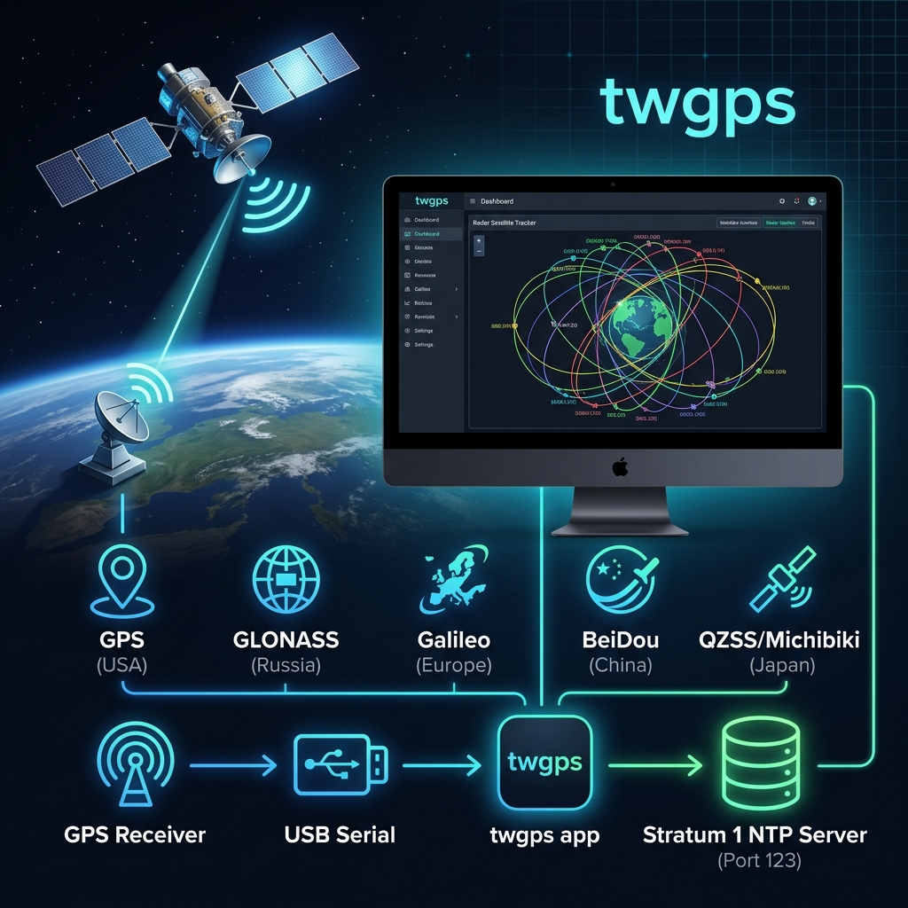
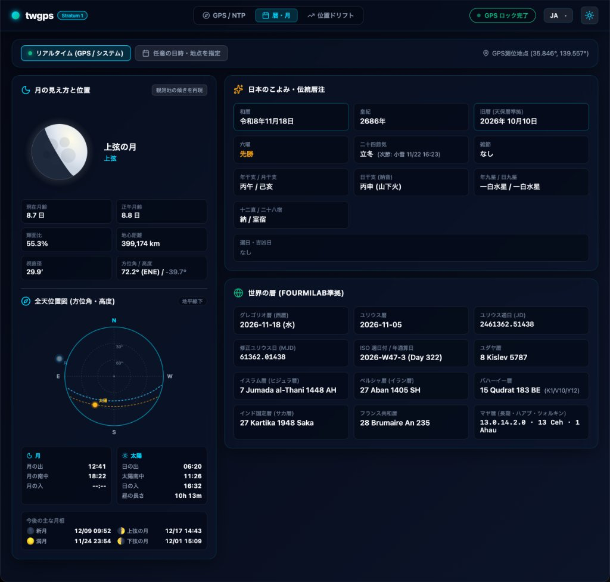
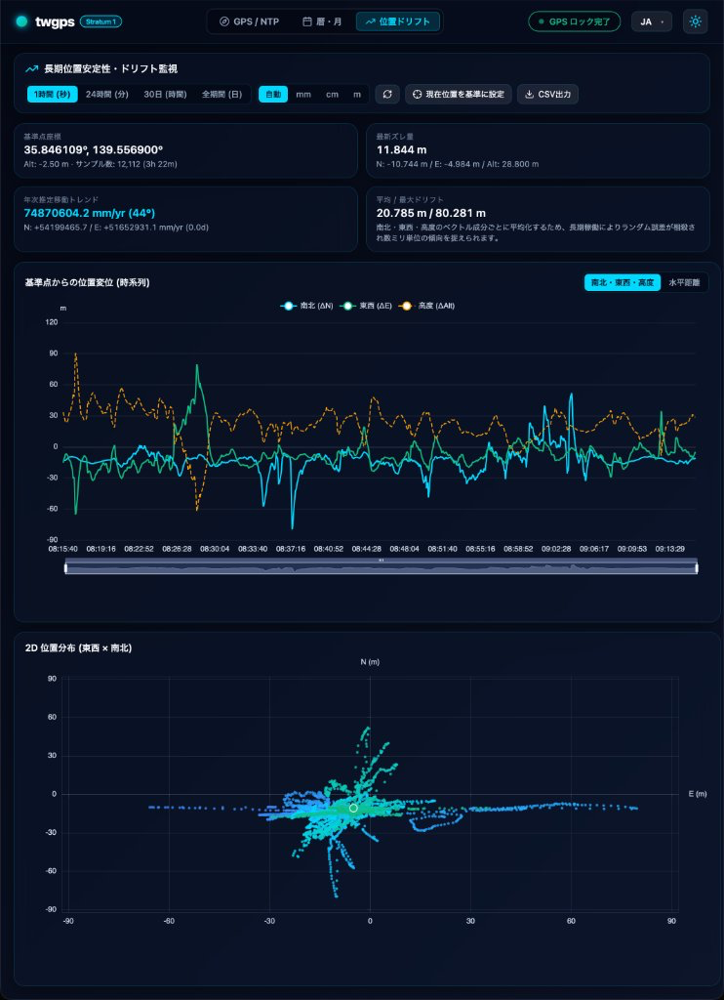

# twgps

[English](README.md)

`twgps` は、PC に接続された USB/シリアル GPS 受信機を利用して、お使いのコンピューターを **Stratum 1 NTP サーバー** にする軽量なマルチプラットフォーム対応のデスクトップアプリケーションです。GPS 受信機を自動的に検出し、衛星の配置や信号強度（SNR）をビジュアル化し、高精度な NTP 時刻を提供します。

[Wails](https://wails.io/) (Go + Svelte) を使用して構築されています。




---

## 必要な機材

本ソフトウェアを使用するには、NMEA 規格に対応した USB 接続の GPS 受信機が必要です。

### 動作確認済み機材:
- **GPSレシーバー GPS受信機 DOCTORADIO GR7-10HZ** (USB NMEA レシーバー)


---

## 主な機能

- **GPS 受信機の自動検出**: すべてのシリアル/USB ポートを一般的なボーレート（115200 および 9600 bps）で自動スキャンし、GPS 受信機を見つけて NMEA センテンスの解析を開始します。
- **衛星情報の視覚表示（3D 地球儀 / 2D スカイプロット）**: 以下の衛星システムのアクティブな衛星番号（PRN）、仰角、方位角、信号強度（SNR）をインタラクティブな 3D 地球儀（WebGL 非対応環境では自動的に 2D スカイプロットへフォールバック）で追跡・表示します：
  - **GPS** (アメリカ)
  - **GLONASS** (ロシア)
  - **Galileo** (欧州)
  - **BeiDou** (中国)
  - **みちびき / QZSS** (日本)
  - **SBAS / MSAS** (衛星静止基準補正システム)
- **静止判定による速度ノイズ除去**: GPS 測位の微小な揺らぎによる速度のふらつきをフィルタリングし、静止状態を判定して「静止」バッジと安定した速度を表示します。
- **内蔵 Stratum 1 NTP サーバー**:
  - GPS 衛星クロックに同期した高精度な時刻を提供。
  - デフォルトで標準の NTP ポートである `123` を使用（任意のポートに変更可能）。
  - 稼働時は基準識別子として `"GPS "` が設定された Stratum 1 NTP 応答を行います。
  - GPS 受信機の測位（3D Fix）が失われた場合は、自動的にシステム時刻を用いた応答へフォールバックします。
- **暦・月ビュー** *(v0.2.0 で追加)*:
  - GPS の高精度な時刻・測位座標（または任意の日時・地点）に基づき、各種暦と天文情報を表示します。
  - **世界の暦**: グレゴリオ暦、ユリウス暦、ユリウス通日（JD）、修正ユリウス日（MJD）、ISO 週日付、ユダヤ暦、イスラム暦（ヒジュラ暦）、ペルシャ暦、バハーイー暦、インド国定暦（サカ暦）、フランス共和暦、マヤ暦。
  - **日本のこよみ・伝統暦注**: 和暦、皇紀、旧暦（天保暦準拠）、六曜、二十四節気・次節、雑節、干支（年・月・日）、納音、九星（年・日）、十二直、二十八宿、選日・吉凶日。
  - **月の見え方と全天位置図**: 現在月齢・正午月齢、輝面比、地心距離、視直径、月相グラフィック、今後の主な月相、太陽・月の出没/南中時刻、および方位角・高度の全天位置図を表示します。
- **長期位置安定性・ドリフト監視** *(v0.2.0 で追加)*:
  - 測位履歴を記録し、基準点からの変位（南北 ΔN・東西 ΔE・高度 ΔAlt）を時間バケットごとに平均化することで、長期稼働時のランダム誤差を相殺し数ミリ単位の変位傾向を捉えます。
  - **1時間（秒）**・**24時間（分）**・**30日（時間）**・**全期間（日）** のタイムスケール切り替え、2D 位置分布（東西×南北）散布図、年次推定移動トレンドの算出に対応。
  - 基準点の再設定および **CSV 出力** 機能を備えています。
- **モダンなユーザーインターフェース**: リアルタイムに更新されるレスポンシブなダッシュボード（ダーク/ライトテーマ対応）と、多言語対応（英語・日本語）を備えています。

---

## スクリーンショット

### 暦・月ビュー


### 長期位置安定性・ドリフト監視


---

## インストール方法

[GitHub の Releases ページ](https://github.com/twsnmp/twgps/releases)から、ビルド済みのバイナリをダウンロードできます。

- **Windows**: `.zip` アーカイブをダウンロードして展開し、`twgps.exe` を実行してください。
- **Linux**: `.tar.gz` アーカイブをダウンロードして展開し、バイナリを実行してください。権限やグラフィックスの設定については、後述の [Linux での使用時の設定](#linux-での使用時の設定) をご覧ください。
- **macOS**: `.pkg` インストーラー（または `.app` バンドル）をダウンロードし、`/Applications` フォルダーへインストールして実行してください。

---

## 操作方法

1. **GPS 受信機の接続**: NMEA 出力に対応した USB またはシリアル接続の GPS 受信機をコンピューターに接続します。
2. **twgps の起動**: アプリケーションを起動します。
3. **自動スキャン**: バックグラウンドでシリアルポートの自動スキャンが開始されます。有効な NMEA データストリームが検出されると、接続ステータスが緑色になり、衛星情報の更新が始まります。
4. **測位の完了**: GPS 受信機が衛星を捕捉し測位（Fix）するまで待ちます。測位が完了すると、経緯度、高度、正確な UTC 時刻がダッシュボードに表示されます。
5. **NTP サーバーの起動**:
   - 動作させたいポート番号を入力します（デフォルトは `123`）。
   - **タイムサーバー起動** ボタンをクリックします。
   - *注意*: Linux や macOS で標準の `123` ポートを使用するには、特権が必要です。後述の [Linux での使用時の設定](#linux-での使用時の設定) を参照してください。
6. **追加ビューの活用**:
   - **暦・月**: 上部ナビゲーションの「暦・月」タブに切り替えると、世界の暦、日本のこよみ、月齢や月の全天位置図を確認できます。
   - **位置ドリフト**: 「位置ドリフト」タブでは、基準点からの長期的な位置変位の推移、2D 位置分布、年次推定移動トレンドの確認や CSV 出力を行えます。

---

## Linux での使用時の設定

### 1. シリアルポートのアクセス権限設定 (Permission Denied 回避)
一般ユーザーのまま USB シリアルデバイス（`/dev/ttyACM0` や `/dev/ttyUSB0` など）にアクセスするには、ユーザーを適切なグループに追加する必要があります。

- **Ubuntu / Debian / Fedora**:
  ```bash
  sudo usermod -a -G dialout $USER
  ```
- **Arch Linux**:
  ```bash
  sudo usermod -a -G uucp $USER
  ```

> [!IMPORTANT]
> グループ設定を反映させるには、**一度ログアウトして再ログイン**（またはシステムを再起動）する必要があります。

#### なぜ `sudo` で `twgps` を起動してはいけないのか
`sudo ./twgps` のようにルート権限で起動すると、`panic: failed to init GTK` というエラーでクラッシュします。これは、ルートユーザーが現在のログインユーザーのディスプレイサーバー（X11 や Wayland）へのアクセス権を持たないためです。必ず一般ユーザーのまま、上記のコマンドでシリアルポートへのアクセス権限を付与してください。

### 2. 特権ポート (123) のバインド設定
Linux では、1024 未満の特権ポート（UDP `123` など）へのバインドはルート権限に制限されています。アプリ全体を `sudo` で動かす代わりに、バイナリに対してネットワークバインド権限のみを付与することができます。

```bash
sudo setcap 'cap_net_bind_service=+ep' ./twgps
```

### 3. 古い GPU やドライバ使用時の画面描画トラブル（画面が真っ白になる問題など）
起動時にウィンドウ内が真っ白な状態のままになったり、アプリがクラッシュしたりする場合、WebKit2GTK とグラフィックスドライバ（古い Intel/AMD チップや Mesa ドライバなど）の相性が原因である可能性があります。
その場合、環境変数を設定して DMABUF レンダリングやハードウェアアクセラレーションを無効化することで解決できます。

```bash
# DMABUF レンダラーを無効化する (古い GPU/Intel/Mesa での推奨設定)
WEBKIT_DISABLE_DMABUF_RENDERER=1 ./twgps

# 描画トラブルが解消しない場合は、コンポジットモードを完全に無効化
WEBKIT_DISABLE_COMPOSITING_MODE=1 ./twgps
```

---

## ローカルでのビルド方法

### 前提条件
ソースコードからビルドするには、以下のツールがインストールされている必要があります。
- **Go**: バージョン 1.26 以上
- **Node.js**: バージョン 20 以上
- **Wails CLI**: バージョン 2
  ```bash
  go install github.com/wailsapp/wails/v2/cmd/wails@latest
  ```
- **Mise** (タスクランナーとして使用可能)

### ビルド手順

1. **リポジトリのクローン**:
   ```bash
   git clone https://github.com/twsnmp/twgps.git
   cd twgps
   ```

2. **開発モードでの起動**:
   ホットリロードが有効な開発用ウィンドウを立ち上げます。
   ```bash
   wails dev
   # または mise を使用する場合:
   mise run dev
   ```

3. **本番用ビルドの生成**:
   実行中の OS に合わせた本番用バイナリをコンパイルします。
   ```bash
   wails build
   # または mise を使用する場合:
   mise run build
   ```

---

## ライセンス

本プロジェクトは Apache License, Version 2.0 の下でライセンスされています。詳細は [LICENSE](LICENSE) ファイルをご覧ください。
